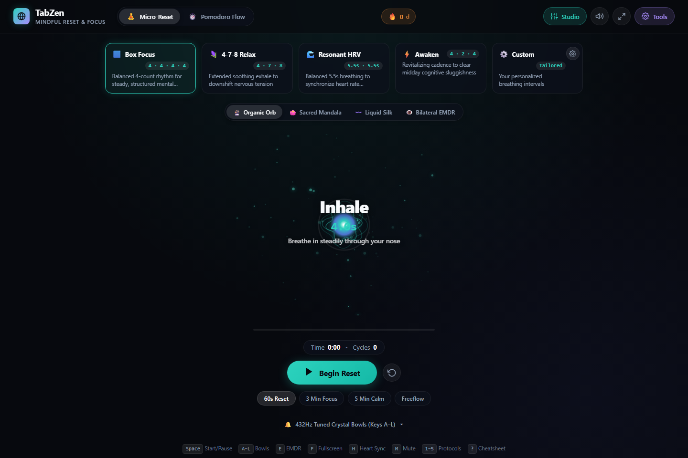
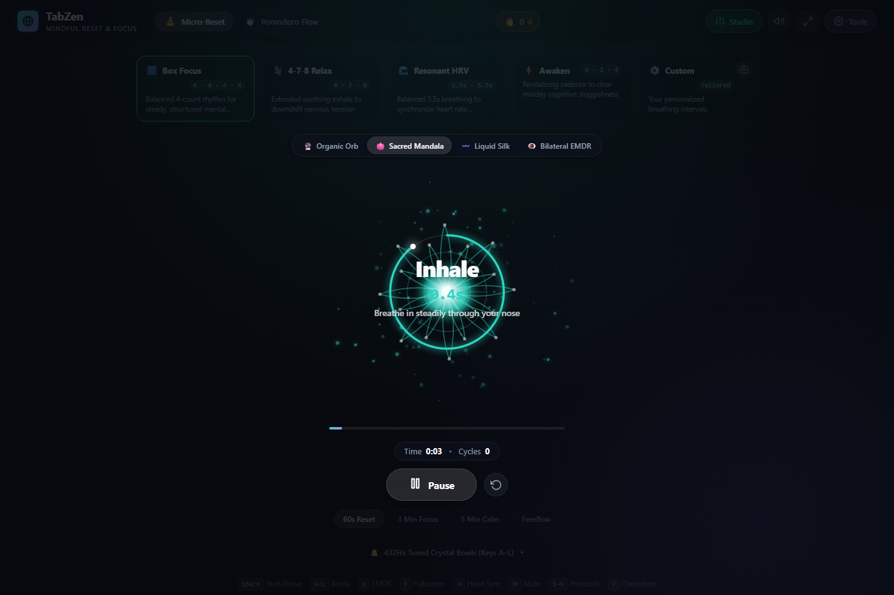
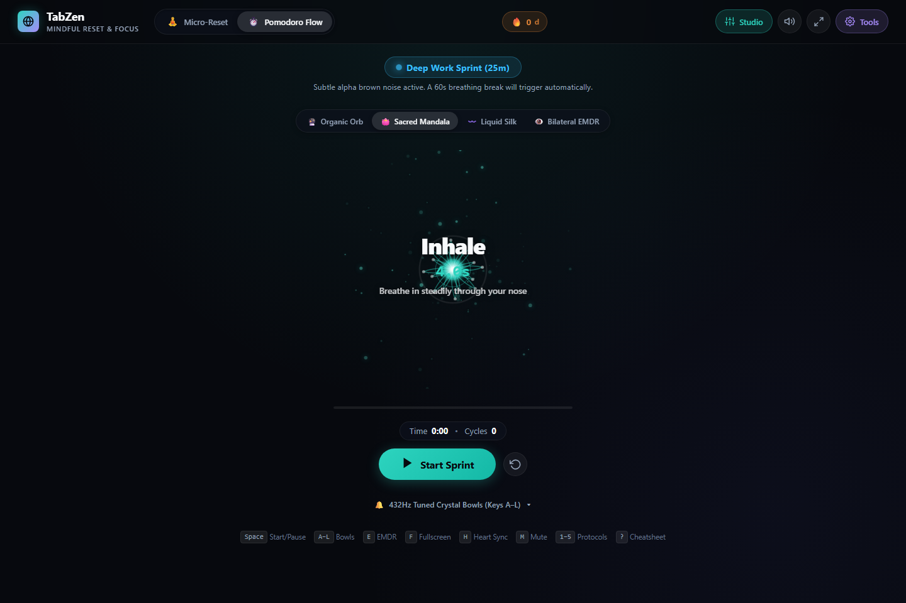
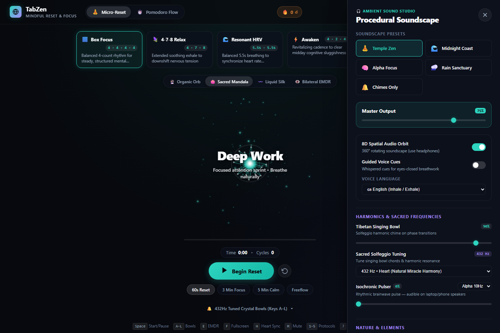
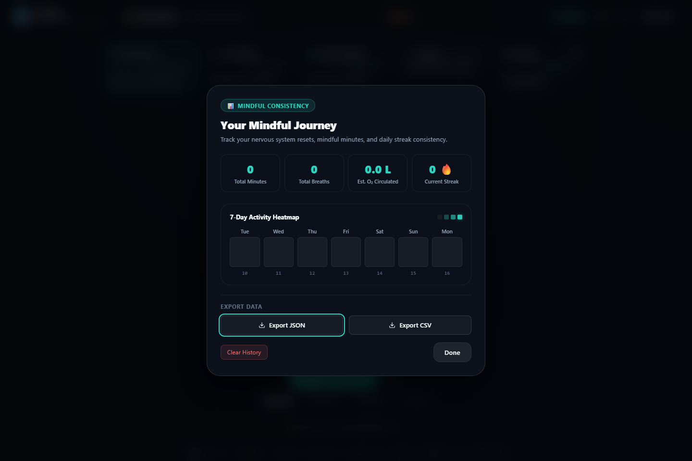
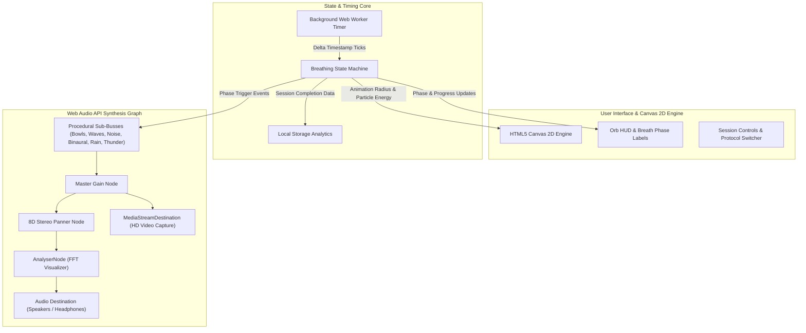
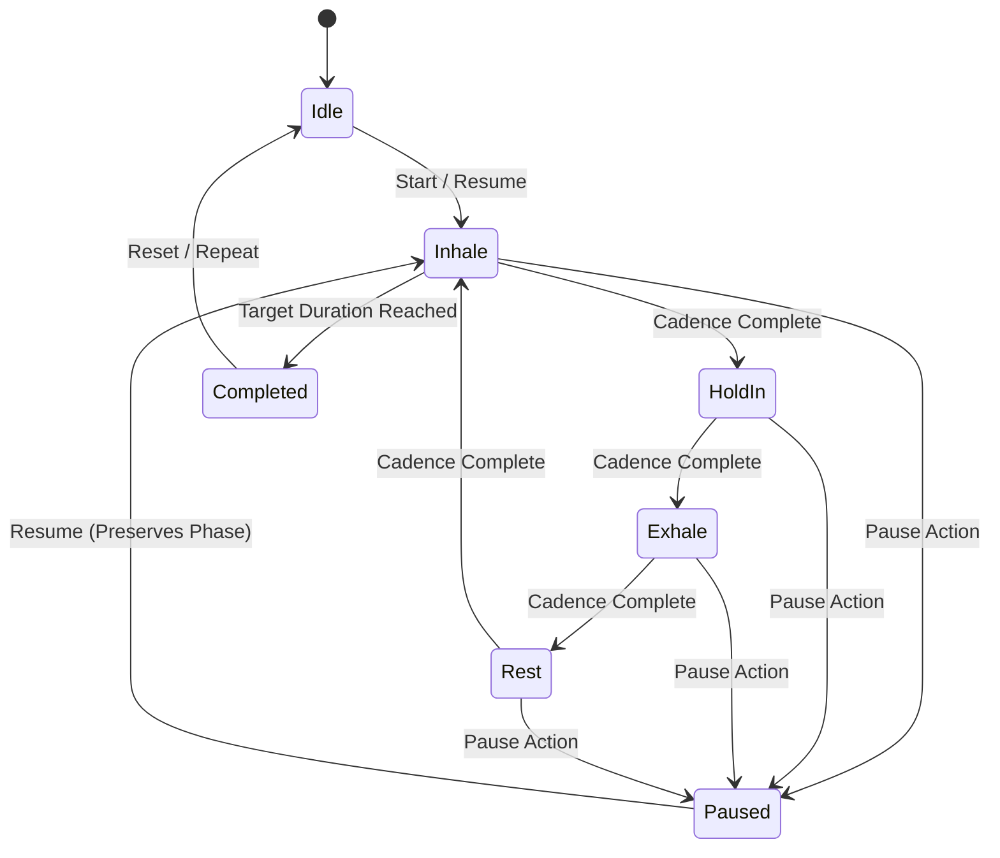

# 🧘‍♂️ TabZen — Mindful Reset & Focus Companion

[](LICENSE)
[](https://developer.mozilla.org/en-US/docs/Web/JavaScript)
[](https://developer.mozilla.org/en-US/docs/Web/API/Web_Audio_API)
[](https://developer.mozilla.org/en-US/docs/Web/API/Canvas_API)
[](manifest.json)
[](#testing--verification)
[](https://tabzen-brown.vercel.app/)

> An open-source, zero-dependency ambient focus companion and somatic reset web application. TabZen combines procedural mathematical sound synthesis, hardware-accelerated HTML5 Canvas visualizers (targeting 60 Hz display refresh with power-saving idle throttling), paced respiratory cadences, and background-resilient Pomodoro timing to reduce screen fatigue and support sustained cognitive deep work.

---

## 🌐 Live Application & Repository

- **Official Live Application**: [https://tabzen-brown.vercel.app/](https://tabzen-brown.vercel.app/)
- **GitHub Repository**: [https://github.com/chintasankarraj/tabzen](https://github.com/chintasankarraj/tabzen)

---

## 📸 Interface Preview

### 1. Main Stage & Respiratory Protocols

*TabZen Calm Premium interface featuring the Organic Orb visualizer, protocol switcher, session statistics, and audio controls.*

### 2. Sacred Mandala Breathing Geometry

*Procedural 8-fold symmetrical blooming mandala synchronizing expansion and contraction with active inhalation and exhalation phases.*

### 3. Pomodoro Deep Work HUD

*25-minute deep focus sprint with subtle brown noise audio synthesis and automatic transition to a 60-second recovery breath break.*

### 4. Ambient Procedural Sound Studio

*Procedural sound synthesizer drawer: Tibetan singing bowls, ocean surf, alpha binaural beats, 8D circular spatial audio, rain, and thunder.*

### 5. Mindful Consistency & Analytics

*Local privacy-first activity tracking: total minutes, breath counts, estimated volume circulated, 7-day consistency heatmap, and JSON/CSV export.*

---

## 📖 About TabZen

### The Challenge: Screen Fatigue & Cognitive Overload
Knowledge workers and software engineers spend hours in high-concentration focus states. During intensive screen sessions, breathing often becomes unconsciously shallow or irregular—a pattern often referred to as screen-induced respiratory shallowing. Over several hours, this pattern elevates sympathetic nervous system tone, accelerates physical fatigue, and fragments attention.

### The TabZen Philosophy: Calm Technology
TabZen was designed under the principles of **Calm Technology**:
- **Zero Asset Overhead**: No bulky MP3s or video backgrounds. Every soundscape, harmonic frequency, and visual effect is computed algorithmically in real time using native browser APIs.
- **Calm Premium Aesthetic**: Grounded in deep Midnight Charcoal (`#07090e`), soothing Luminous Teal (`#2dd4bf`), and Ethereal Lavender (`#a78bfa`), TabZen minimizes eye strain with subdued contrasts and glassmorphic translucent surfaces.
- **Privacy by Default**: All session metrics and streaks stay entirely in your browser's `localStorage`. No telemetry, no accounts, and no third-party tracking cookies.

---

## ✨ Key Features

### 1. Mindfulness & Somatic Reset
- **Five Structured Respiratory Protocols**:
  - **Box Focus (4 · 4 · 4 · 4)**: Equal-ratio cadence designed to establish mental stability and composure.
  - **4-7-8 Relax (4 · 7 · 8)**: Extended exhalation cadence to support parasympathetic downshifting.
  - **Resonant HRV (5.5s · 5.5s)**: Balanced 0.1 Hz respiratory frequency supporting heart rate variability coherence.
  - **Awaken (4 · 2 · 4)**: Revitalizing rhythm to dispel afternoon lethargy.
  - **Custom Tailored**: Interactive duration sliders allowing personalized inhale, hold, exhale, and rest intervals.
- **Four Dynamic Visualizer Modes**:
  - **Organic Orb**: Luminous central sphere with floating gravitational particle physics.
  - **Sacred Mandala**: Multi-layered geometric blooming lotus governed by Bezier curve mathematics.
  - **Liquid Silk**: Undulating multi-frequency harmonic wave ribbons.
  - **Bilateral EMDR Guide (<kbd>E</kbd>)**: Horizontal smooth-pursuit pacing target for bilateral visual tracking.
- **Multi-Lingual Whispered Voice Guidance**:
  - Integrated via native `window.speechSynthesis` with delicate vocal cadence in **7 languages**: English, Spanish, French, German, Japanese, Hindi, and Telugu.

### 2. Deep Work & Focus Management
- **Pomodoro Flow Architecture**:
  - 25-minute focused sprint pairing minimal UI distraction with low-intensity alpha waves and brown noise.
  - Automatic transition into a mandatory 60-second recovery breath break upon sprint completion.
- **Web Worker Background Delta Timing**:
  - Timing is decoupled from `requestAnimationFrame` and driven by timestamp delta calculation and an isolated Web Worker, ensuring timer integrity when switching browser tabs.

### 3. Procedural Audio Synthesizer
- **100% Mathematical Sound Generation**:
  - **Tibetan Singing Bowl**: Multi-oscillator additive synthesis with exponential amplitude decay.
  - **Tidal Ocean Waves**: Resonantly filtered pink and brown noise modulated to natural surf periods.
  - **Binaural Alpha Waves**: Stereo carrier frequencies (216 Hz left / 226 Hz right) producing a 10 Hz binaural beat in stereo headphones.
  - **Procedural Rain & Thunder**: Algorithmic white noise burst synthesis for droplets with low-pass resonant sweeps for thunder claps.
  - **432Hz Crystal Singing Bowls (<kbd>A</kbd>–<kbd>L</kbd>)**: Nine interactive Solfeggio pentatonic keyboard triggers producing visual shockwaves.
  - **8D Spatial Audio Orbit**: Low-frequency sinusoidal panning (`StereoPannerNode`) rotating the ambient soundscape across a 360-degree auditory field.

### 4. Personal Insights & Biometrics
- **Heart Sync Pulse Biofeedback**:
  - Tap-tempo inter-beat interval estimator calculating heart rate (clamped within physiological bounds of 45–140 BPM) with rhythm regularity estimation.
- **Acoustic Breath Tracking**:
  - Optional microphone input using real-time Web Audio RMS envelope analysis (250 Hz–1600 Hz bandpass filter) that dynamically scales visualizer energy with physical exhalations.
- **Data Integrity & Export**:
  - Daily mindful minutes, breath cycles, and current streak tracking.
  - 7-day consistency activity heatmap.
  - Full data portability with RFC 4180-compliant CSV and JSON export options.

### 5. Accessibility & UX Polish
- **Engineered to WCAG 2.1 AA Guidelines**:
  - Interactive touch targets enlarged to at least 44×44 CSS pixels on touch devices.
  - Accessible modal dialogs with focus trapping and automatic focus restoration.
  - Standardized keyboard navigation with `Escape` modal dismissal.
  - Native `prefers-reduced-motion` media query support.

---

## 🛠️ Technology Stack

| Layer | Technologies Used | Purpose |
|---|---|---|
| **Architecture** | Vanilla JavaScript (ES6+), Semantic HTML5, CSS3 | Zero runtime dependencies, instant execution, zero bundler complexity |
| **Audio Synthesis** | Web Audio API (`AudioContext`, `BiquadFilterNode`, `StereoPannerNode`, `GainNode`) | Real-time procedural ambient sound, spatial panning, and crystal chimes |
| **Visual Rendering** | HTML5 Canvas 2D Context | High-DPI hardware-accelerated particle systems and geometry targeting 60 Hz with idle throttling |
| **Speech Engine** | Web Speech Synthesis API (`SpeechSynthesisUtterance`) | Multi-lingual whispered vocal cues |
| **Concurrency** | Web Workers API (`Worker`) | Background timer scheduling immune to browser tab throttling |
| **Offline & PWA** | Service Worker API (`CacheStorage`), Web App Manifest | Asset caching and standalone desktop/mobile installation |
| **Styling** | CSS Custom Properties, Glassmorphism Backdrop Filters | Scalable theming, dynamic focus dimming, and responsive layouts |

---

## 🏗️ System Architecture & Data Flow



### Breathing Engine State Machine


---

## 📂 Project Structure

```text
tabzen/
├── css/
│   └── styles.css              # Design system, glassmorphism, responsive styles
├── docs/
│   └── screenshots/            # High-resolution interface screenshots
│       ├── analytics-dashboard.png
│       ├── breathing-mandala.png
│       ├── main-interface.png
│       ├── pomodoro-flow.png
│       └── sound-studio.png
├── icons/
│   ├── apple-touch-icon.png    # iOS touch icon
│   ├── favicon-32x32.png       # Browser favicon
│   ├── icon-192x192.png        # Standard PWA icon
│   ├── icon-512x512.png        # High-res PWA icon
│   └── maskable-icon-512x512.png # Adaptive maskable icon
├── js/
│   ├── app.js                  # Application orchestrator, UI binding, modals, analytics
│   ├── audio-engine.js         # Procedural Web Audio API sound synthesizers
│   ├── breathing-engine.js     # State machine, cadences, Web Worker timing
│   └── visualizer.js           # Canvas particle systems, mandala geometry, EMDR
├── index.html                  # Semantic application markup and modal containers
├── manifest.json               # Progressive Web App configuration manifest
├── package.json                # Project scripts and syntax testing configuration
├── sw.js                       # Service Worker caching and offline management
└── README.md                   # Comprehensive technical documentation
```

---

## 🚀 Getting Started

### Prerequisites
TabZen runs directly in any modern, standards-compliant web browser supporting the Web Audio API and HTML5 Canvas (Google Chrome, Microsoft Edge, Mozilla Firefox, Apple Safari).

### Local Installation

1. **Clone the repository:**
   ```bash
   git clone https://github.com/chintasankarraj/tabzen.git
   cd tabzen
   ```

2. **Launch a local static server:**
   Using Node.js:
   ```bash
   npx serve . -l 3000
   ```
   Or using Python:
   ```bash
   python -m http.server 3000
   ```

3. **Open the application:**
   Navigate to `http://localhost:3000` in your browser.

4. **Verify syntax:**
   ```bash
   npm run check
   ```

---

## 📱 PWA & Browser Compatibility

### Progressive Web App (PWA)
TabZen includes an updated Web App Manifest (`manifest.json`) and Service Worker (`sw.js`). You can install TabZen directly to your operating system desktop or mobile home screen via the browser address bar icon.

### Technical & Browser Notes
- **Offline Caching**: Static assets (HTML, CSS, JavaScript, icons) are cached on initial load using a stale-while-revalidate strategy. Note: Full offline navigation reload under certain Chromium network states is currently under continuous evaluation.
- **Autoplay & Audio Permissions**: Browsers enforce an audio security policy requiring an explicit user interaction (click or keypress) before resuming the `AudioContext`.
- **Acoustic Breath Tracking**: The microphone feature requires user-granted microphone permissions. All audio processing is handled locally via an `AnalyserNode`; no audio is recorded, transmitted, or saved.
- **Mobile Background Audio**: Mobile operating systems (iOS Safari and Android Chrome) intentionally suspend Web Audio contexts when tabs enter the background to conserve power.
- **Video Recording**: High-definition video recording utilizes `HTMLCanvasElement.captureStream()` and `MediaRecorder` in WebM format, supported in Chromium and Firefox browsers.

---

## 🧪 Testing & Verification

The project underwent an automated pre-deployment regression audit covering critical functional, accessibility, and performance flows across 85 verified test cases:

```text
======================================================================
  TABZEN COMPREHENSIVE REGRESSION SUITE (85/85 PASSING)
======================================================================
  [✓] Phase 1: Critical Bug Fixes (12 tests)
      - Paused protocol switching preserves pause state without auto-play
      - Play/Pause button UI synchronizes with engine state machine
      - Visualizer canvas properly clears on protocol switch
  [✓] Phase 2: Reliability & Data Integrity (20 tests)
      - Web Worker delta timer maintains accuracy under tab throttling
      - Pulse tap tempo calculation bounded to [45, 140] BPM
      - RFC 4180 CSV export properly escapes commas, quotes, and newlines
  [✓] Phase 3: Accessibility & Performance (28 tests)
      - Header buttons satisfy 44x44px touch target thresholds on mobile
      - Modal focus trapping, tab loops, and Escape key dismissal
      - Audio node lifecycle prevents disconnected oscillator leaks
      - prefers-reduced-motion media queries disable intense animations
  [✓] Phase 4: PWA, Manifest & Service Worker (25 tests)
      - Physical PNG icons verified across 192px, 512px, maskable, and Apple
      - Service worker cache versioning safely replaces outdated assets
      - Zero broken file references or missing module imports
======================================================================
  Final Result: 85 passed, 0 failed, 0 regressions
======================================================================
```

---

## ⌨️ Keyboard Shortcuts Reference

TabZen offers complete hotkey navigation for keyboard-centric workflows:

| Key | Action | Context |
|---|---|---|
| <kbd>Space</kbd> | Start / Pause Breathing Session | Global |
| <kbd>R</kbd> | Reset Session to Start | Global |
| <kbd>1</kbd> | Switch to Box Focus (4-4-4-4) | Global |
| <kbd>2</kbd> | Switch to 4-7-8 Relax | Global |
| <kbd>3</kbd> | Switch to Resonant HRV (5.5s) | Global |
| <kbd>4</kbd> | Switch to Awaken (4-2-4) | Global |
| <kbd>5</kbd> | Switch to Custom Protocol | Global |
| <kbd>A</kbd>–<kbd>L</kbd> | Play 432Hz Tuned Crystal Bowls (D4 to A5) | Global |
| <kbd>E</kbd> | Toggle Bilateral EMDR Eye Movement Guide | Global |
| <kbd>F</kbd> | Toggle Zen Fullscreen Mode | Global |
| <kbd>H</kbd> | Open Heart Sync Pulse Tracker | Global |
| <kbd>M</kbd> | Mute / Unmute Audio Synthesizer | Global |
| <kbd>?</kbd> | Open Keyboard Shortcuts Cheatsheet | Global |
| <kbd>Esc</kbd> | Close Any Open Modal Dialog or Drawer | Modals / Drawers |

---

## 🔮 Future Enhancements

- [ ] **Web Bluetooth (BLE) Heart Rate**: Connect compatible Bluetooth Low Energy pulse sensors for continuous biofeedback.
- [ ] **Binaural Customization**: Interactive frequency sliders for custom delta (1–4 Hz), theta (4–8 Hz), and gamma (30–50 Hz) entrainment.
- [ ] **Encrypted Local Export**: Passphrase-protected encrypted backup and sync across devices.
- [ ] **Ambient Dark Mode Profiles**: Additional monochromatic high-contrast themes for outdoor visibility.

---

## 📄 License

This project is licensed under the **MIT License** — see the [LICENSE](LICENSE) file for full details.
